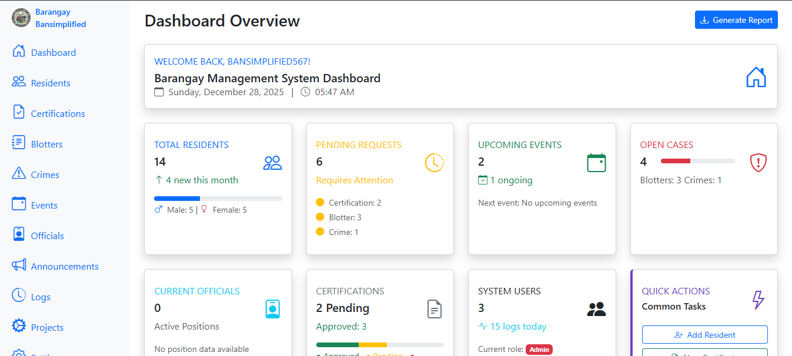
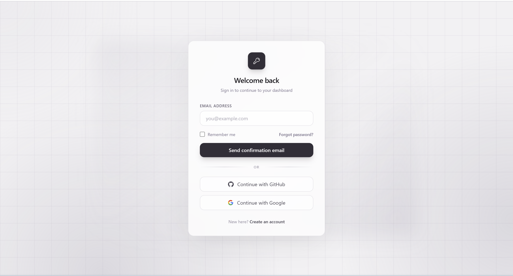
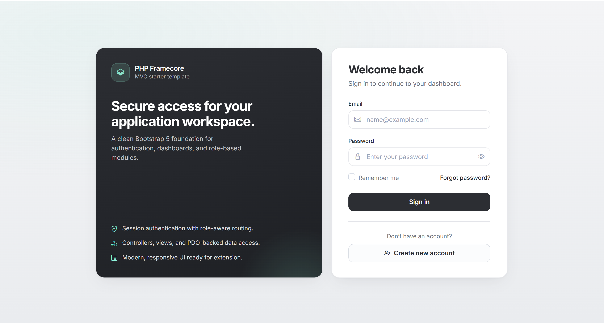

<p align="center">
  
</p>

<p align="center">
  <a href="https://github.com/BanSimplified567">
    
  </a>
  <a href="mailto:bansimplified567@gmail.com">
    
  </a>
  <a href="https://bansimplified.vercel.app/">
    
  </a>
</p>

---

## 👨‍💻 About Me

```yaml
name: "Jade Ivan V. Bringcola (Kaizen)"
location: "Cebu City, Philippines"
role: "Full-Stack Software Engineer"
education:
  - "BS in Information Technology @ Sibonga Community College of the Philippines (2025)"
current:
  - "Freelance Full-Stack Developer @ Sibonga Cebu"
  - "LGU Worker @ Municipal Health Office, Sibonga, Cebu"
  - "MADAC Staff (Encoder), IT Support, HR Staff"
interests: ["Filipino Martial Arts (FMA)", "Capstone Systems", "Open Source", "AI & Automation"]
```

---

## 🛠 Tech Stack

**Daily at Work**


**Side Projects**


**Infra & Testing**


**AI & Automation**


---

## 📊 GitHub Stats

<p align="center">
  
  
</p>

<p align="center">
  
</p>

---

## ⏱ WakaTime Stats

<p align="center">
  
  

</p>

---

## 🚀 Featured Projects

### 01. Barangay Management System
 

| | |
|---|---|
| <a href="https://github.com/BanSimplified567/Barangay_Management"></a> | **Description:** A web-based management system designed to support barangay operations and streamline day-to-day administrative work.<br/><br/>**Key Features:**<br/>• Resident records management<br/>• Permit and document processing<br/>• Incident recording and monitoring<br/><br/>**Stack:** `PHP` · `MySQL` · `JavaScript`<br/><br/>[**View Repository ↗**](https://github.com/BanSimplified567/Barangay_Management) |

---

### 02. Hotel Reservation Management (HRM)
 

| | |
|---|---|
| <a href="https://github.com/BanSimplified567/Hotel-Reservation-Management--HRM-"></a> | **Description:** A hotel operations platform for managing reservations, room information, guest access, and payment records.<br/><br/>**Key Features:**<br/>• User authentication and access management<br/>• Room and booking management<br/>• Payment tracking and reporting<br/><br/>**Stack:** `PHP` · `MySQL` · `Bootstrap`<br/><br/>[**View Repository ↗**](https://github.com/BanSimplified567/Hotel-Reservation-Management--HRM-) |

---

### 03. MotorStart Website
 

| | |
|---|---|
| <a href="https://github.com/BanSimplified567/MotorStart-Website"></a> | **Description:** An automotive e-commerce website for showcasing and selling motorcycle parts and accessories.<br/><br/>**Key Features:**<br/>• Product browsing and catalog presentation<br/>• Automotive parts and accessories listings<br/>• Responsive website interface<br/><br/>**Stack:** `PHP` · `MySQL` · `JavaScript`<br/><br/>[**View Repository ↗**](https://github.com/BanSimplified567/MotorStart-Website) |

---

### 04. BanHotel
 

| | |
|---|---|
| <a href="https://github.com/BanSimplified567/BanHotel"></a> | **Description:** A hotel booking and discovery platform built to present accommodation options and support the reservation journey.<br/><br/>**Key Features:**<br/>• Hotel and accommodation discovery<br/>• Booking-focused user experience<br/>• Web-based interface for browsing stays<br/><br/>**Stack:** `JavaScript` · `CSS` · `HTML`<br/><br/>[**View Repository ↗**](https://github.com/BanSimplified567/BanHotel) |

---

### 05. Bansimplified Boilerplate (React)
 

| | |
|---|---|
| <a href="https://github.com/BanSimplified567/bansimplified-boilerplate-using-react"></a> | **Description:** A reusable starter kit designed to accelerate development of modern React applications with Supabase and TanStack tooling.<br/><br/>**Key Highlights:**<br/>• Reusable project structure for rapid development<br/>• Supabase integration for backend services<br/>• TanStack Router and Query setup<br/><br/>**Stack:** `TypeScript` · `Next.js` · `Tailwind CSS` · `Supabase` · `TanStack`<br/><br/>[**View Repository ↗**](https://github.com/BanSimplified567/bansimplified-boilerplate-using-react) |

---

### 06. Bansimplified Boilerplate (PHP)
 

| | |
|---|---|
| <a href="https://github.com/BanSimplified567/bansimplified-boilerplate-using-php-native"></a> | **Description:** PHP_Framecore is a lightweight native-PHP starter framework with role-based access control and routing.<br/><br/>**Key Highlights:**<br/>• Lightweight native PHP foundation<br/>• Role-based access control (RBAC)<br/>• Reusable structure for PHP and MySQL applications<br/><br/>**Stack:** `PHP` · `MySQL`<br/><br/>[**View Repository ↗**](https://github.com/BanSimplified567/bansimplified-boilerplate-using-php-native) |

---

## 🏆 Achievements

- **BS IT Graduate** — Sibonga Community College of the Philippines (2026)
- **5 Capstone Projects** delivered during college
- **3+ Live Applications** in production
- **3+ Years** freelance web development experience

---

## 📈 Contribution Graph

<p align="center">
  
</p>

---

## 📫 Let's Connect

<p align="center">
  <a href="https://github.com/BanSimplified567" target="_blank">
    
  </a>
  <a href="mailto:bansimplified567@gmail.com">
    
  </a>
  <a href="https://bansimplified.vercel.app/" target="_blank">
    
  </a>
</p>

---

## 👥 Visitor Analytics

<p align="center">
  
  
</p>


---

<p align="center">
  <i>"I build capstone-level systems with ReactJS, Next.js, Laravel, and GraphQL.<br/>Currently a freelance developer, LGU worker, and Filipino martial artist.<br/>I find joy in learning technology."</i>
</p>
